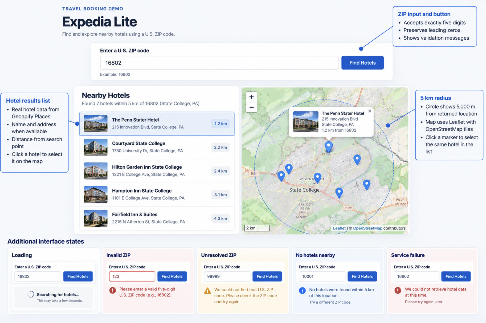

# Assignment 2 Part 1 — Research and Design

## 1. Geoapify Places API
Source: https://apidocs.geoapify.com/docs/places/

What the API provides:
- Hotel locations and available place information.
- Geographic filtering using a 5,000-meter radius.
- Coordinates for displaying hotels on a map.

Design decision:
Use FastAPI to request real hotel data from Geoapify.

## 2. Leaflet
Source: https://leafletjs.com/examples/quick-start/

Useful features:
- Interactive map markers.
- Clickable markers and popups.
- Map movement and zoom controls.

Design decision:
Connect each hotel list entry with its corresponding map marker.

## 3. Existing Hotel Search Interface

Application reviewed:
Google Hotels 
https://www.google.com/travel/search?qs=OAA&utm_source=chatgpt.com&ved=0CAAQ5JsGahcKEwiIwLX5sdiXAxUAAAAAHQAAAAAQBQ&ap=KigKEgltsXHyO2REQBEGOJZevHdTwBISCf4UFl4gaERAEQY4lh7CdVPA

Useful interaction:
Shows pins on the map with prices of the hotels. It also allows you to see what's around the places you want to book at such as food and transit. Has filters and dates so they can be suited to your needs.

Weakness or missing feature:
No weaknesses that I can see.

Design decision:
The reviews and photos I feel are the strongest part of this UI. It allows users to actually see what they're paying for and how others reacted to their stay.

## 4. Early Mockup

The mockup expands my existing Expedia Lite application with
ZIP-code hotel discovery. The design uses a search field at the
top, nearby hotel results on the left, and an interactive
Leaflet map on the right.

Selecting a hotel in either the list or map will highlight
the corresponding location in both views.

I also planned separate feedback for loading, invalid ZIP
codes, unresolved ZIP codes, no nearby hotels, and API failures.

The example hotel data in this mockup is illustrative.
The completed application will display actual Geoapify results
without inventing missing information.

## 5. Planned Application States

- Valid ZIP and hotel results
- Invalid ZIP
- Unresolved ZIP
- Loading
- No hotels nearby
- API or service failure