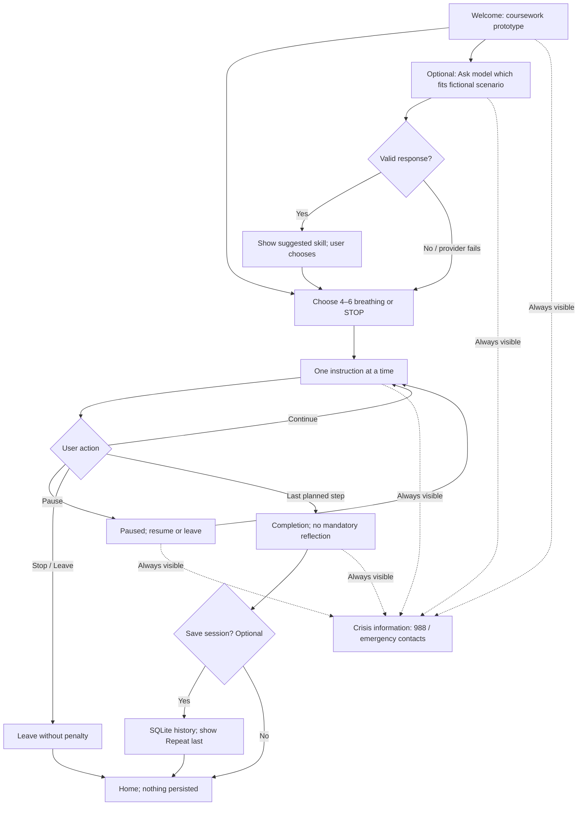

# PausePath — Early Experience Flow (Assignment 3.1)

This design flow is **not a claim of a running application**. It shows the planned screens and where control belongs. Persistent **Crisis information** and **Stop / Leave** do not require AI.

## Fixed exercise details

- **Breathing:** Inhale for 4 counts; exhale for 6; six cycles = 60 seconds. The clock and script live in Vue, not in LLM output.
- **STOP:** Stop → Take a step back → Observe inside and outside → Proceed mindfully. Four approximately 15-second steps for a proposed 60-second path; allow Pause/Back/Leave.
- **Timing:** Starts on first displayed exercise instruction, not on loading/entry. Intended time <90 seconds; measure actual timings in Parts 3.2 and 3.3. Do not hide help or exit on timer expiry.
- **Model:** Only optional skill selection from an allowlist; failure falls back to static choices. Its text cannot hide help or change the sequence.

## Safety path

The **Crisis information** link is part of the app shell and remains available whether the app is on Home, Skill, Paused, Completion or an error view. The route contains static links to [988 Lifeline](https://988lifeline.org/get-help/) and emergency information; no model request is necessary. Fictional test data only.
