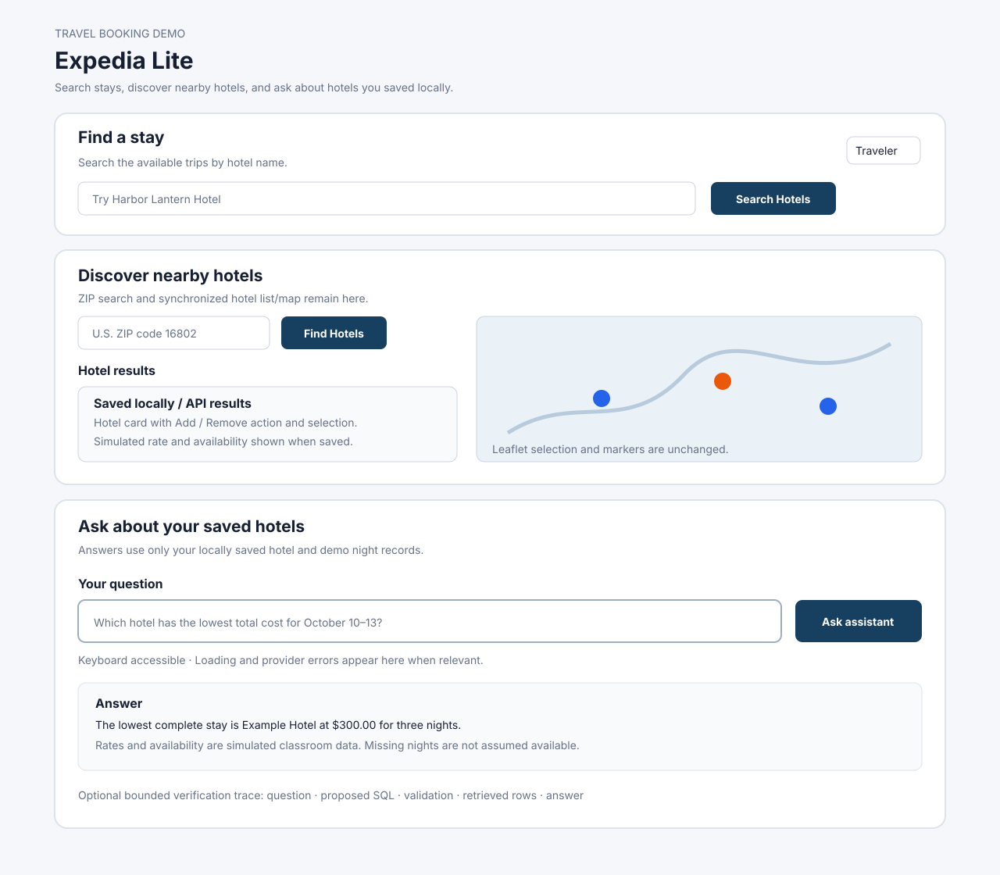

# Expedia Lite — Revised Assignment 2 Part 2 Report

## Repository and Implementation

**Repository:** https://github.com/ManzanKid/part1_travel_app

**Branch:** `assignment2-part2-rag`

**Implementation commit:** `7ccdcfe1ce782d0481a4947cc49b1fb6f698abac

**Verification date:** October 27, 2026

## Project Overview

For Revised Assignment 2 Part 2, I expanded my Expedia Lite application by implementing a business intelligence chatbot using SQL-based Retrieval-Augmented Generation (RAG) and an LLM.

The chatbot allows users to ask natural-language questions about locally saved hotels, simulated nightly rates, and room availability.

The application sends the question to an LLM to generate a SQL query. The FastAPI backend validates the query and retrieves matching information from SQLite. The retrieved records are then sent to the LLM in a second request to generate an answer grounded in the database.

I preserved the existing hotel discovery map, Geoapify API, Add to Local and Remove from Local functions, and Assignment 1 booking functionality.

## Research and Design

My research focused on using LLMs for SQL generation, safely retrieving SQLite data, and preventing generated answers from containing unsupported information.

I used OpenRouter to access an LLM through the FastAPI backend. I also used the existing SQLite database as the retrieval source instead of implementing a vector database.

**Research document:** [Assignment 2 Part 2 Research](docs/assignment2-part2-research.md)

**Early chatbot mockup:**



The chatbot was integrated into the existing Vue interface rather than creating a separate application. The final implementation also provides a verification trace showing the generated SQL, validation result, retrieved records, and final answer.

The mockup was created during the coding-agent implementation process. Its exact creation order relative to the first chatbot code changes has not been independently established.

### Reference Sources

- [OpenRouter documentation](https://openrouter.ai/docs)
- [SQLite documentation](https://www.sqlite.org/docs.html)
- [FastAPI documentation](https://fastapi.tiangolo.com/)
- [Vue documentation](https://vuejs.org/)

## Implementation

### Local Database

The application uses the SQLite database at `backend/data/expedia_lite.db`.

The local-storage foundation includes:

- `saved_hotels` for hotel information.
- `saved_hotel_locations` for searched ZIP associations.
- `demo_hotel_nights` for nightly rates and room availability.

Nightly rates and room counts are simulated classroom information and do not represent real hotel bookings or prices.

### Backend RAG Workflow

The RAG implementation is located in `backend/controllers/hotel_rag_controller.py`.

The chatbot endpoint is:

`POST /api/chatbot/ask`

The workflow is:

1. The frontend submits a natural-language question.
2. The backend sends the question and allowed database schema to the LLM.
3. The LLM proposes a SQL query.
4. FastAPI validates the proposed SQL.
5. The application executes approved read-only SQL against SQLite.
6. Retrieved records are sent to the LLM in a second request.
7. The generated answer is returned to the Vue frontend.

The remote model never directly accesses the SQLite database.

### SQL Security

The backend restricts generated SQL to permitted read-only queries over approved local hotel tables.

The implementation uses bounded queries, read-only SQLite connections, and SQL authorization checks.

Unsafe statements, including DELETE, UPDATE, DROP, multiple statements, and unauthorized table access, are rejected.

### Frontend

The chatbot interface is implemented in `frontend/src/components/HotelChatbot.vue`.

Users can enter natural-language questions, submit them, and view generated answers. The interface also handles loading states, unsuccessful requests, and situations where the database contains insufficient information.

A verification trace provides additional information about the backend retrieval process.

## Startup and Configuration

The application uses a FastAPI backend and Vue frontend.

API credentials are stored in the root `.env` file, which is excluded from Git.

Required environment variables include:

- `GEOAPIFY_API_KEY`
- `OPENROUTER_API_KEY`
- `OPENROUTER_MODEL`

The chatbot was configured to use a free OpenRouter model. The intended model configuration was `nvidia/nemotron-3-ultra-550b-a55b:free`; this should be checked against the final backend runtime configuration.

### Start the backend

```bash
cd backend
source .venv/bin/activate
pip install -r requirements.txt
uvicorn main:app --reload --port 8000
```

### Start the frontend

```bash
cd frontend
npm install
npm run dev
```

**Frontend:** http://localhost:5173/

**Backend:** http://127.0.0.1:8000/

## Verification

### Test 1 — Successful RAG Question

**Question:**

Which of my saved hotels in ZIP code 16802 has rooms available from October 10 to October 13, 2026, and what is the total cost for the stay?

**Expected result:**

The chatbot should retrieve saved nightly records, exclude the checkout date, check availability for all three nights, and calculate the total simulated cost.

**Observed result:**

The chatbot identified Scholar Hotel State College and calculated a total of **$111.00**.

The retrieved nightly records were:

| Date | Nightly Rate | Rooms Available |
|---|---:|---:|
| October 10, 2026 | $5.00 | 10 |
| October 11, 2026 | $100.00 | 20 |
| October 12, 2026 | $6.00 | 20 |

The checkout date, October 13, was correctly excluded.

The backend calculated 11,100 cents ($111.00), with no missing nights and rooms available on all three nights.

### Test 2 — RAG Verification Trace

**Expected result:**

The application should demonstrate SQL generation, validation, SQLite retrieval, and a grounded final answer.

**Observed result:**

The LLM generated a bounded SELECT query joining `saved_hotels`, `saved_hotel_locations`, and `demo_hotel_nights`.

The backend reported:

`accepted: one bounded read-only SELECT over the saved-hotel allowlist`

The query retrieved three nightly records for Scholar Hotel State College.

The verification trace reported:

- `retrieved_record_count`: 3
- `complete`: true
- `available_for_entire_stay`: true
- `missing_dates`: []
- `total_cents`: 11100

The final chatbot answer matched the retrieved records.

The backend implementation and automated success test also confirmed two separate model requests: SQL generation followed by grounded answer generation.

### Test 3 — No Matching Hotels

**Question:**

Do I have any saved hotels in ZIP code 99999?

**Expected result:**

The chatbot should report that there are no matching saved hotels rather than inventing information.

**Observed result:**

The chatbot returned a no-match response.

### Test 4 — SQL Security

**Expected result:**

Dangerous SQL proposals should be rejected before execution without changing database records.

**Observed result:**

Automated tests used temporary SQLite databases and mocked model responses.

The tests submitted DELETE, UPDATE, DROP, multiple-statement, and unauthorized-table proposals through the RAG workflow.

All were rejected, and the saved-hotel count remained **3 before and 3 after** each attempt.

Snapshots of saved hotels, ZIP associations, and nightly records also remained unchanged.

These security tests did not execute malicious queries against my real application database.

### Test 5 — Automated Tests

The backend test suite passed **45 tests**, including **19 RAG tests**.

The tests covered SQL security, database retrieval, successful model interactions using mocks, and regression behavior.

The frontend production build also completed successfully.

These automated results are separate from the successful live-model question and manual browser observations.

**Fixed JSON test fixture:** [Hotel RAG Mock Responses](backend/tests/fixtures/hotel_rag_mock_responses.json)

To repeat the automated checks, activate the backend virtual environment and run:

```bash
python -m pytest -q
```

The fixed JSON responses are test fixtures, not records retrieved from the live hotel provider.

## Demonstration Video

I recorded a demonstration of the Revised Assignment 2 Part 2 chatbot.

**Video:** [Assignment 2 Part 2 RAG Chatbot Demonstration](https://drive.google.com/file/d/1JCLGy10HzZysT2J5TBvmnAOSSQUnCXtv/view?usp=sharing)

The demonstration is intended to provide evidence of the working chatbot, SQL verification trace, database retrieval, generated answer, and relevant tests.

## AI Disclosure and Development Process

I used OpenAI ChatGPT (GPT-6) for implementation guidance, debugging, and verification planning.

I also used OpenAI Codex in VS Code Agent mode to inspect the repository, modify code, generate tests, and help implement the RAG workflow.

**Codex model version:** [Enter the exact model shown in your Codex session, if available.]

The application uses an OpenRouter-hosted LLM for SQL generation and grounded answering.

Representative coding-assistant instructions included:

- Implement a SQL-based RAG chatbot while preserving the existing Expedia Lite functionality.
- Generate read-only SQL using an allowlisted SQLite schema.
- Validate SQL before executing it and prevent unauthorized database modifications.
- Send retrieved records to the LLM in a second request for grounded answering.
- Test malicious SQL proposals against temporary databases and mocked model responses.

### Problems and Revisions

During initial browser testing, the chatbot returned a Not Found error. I discovered that the running FastAPI backend did not expose the new chatbot endpoint and restarted the backend.

After configuring the OpenRouter API key, the application returned an empty answer-service response. I used Codex to investigate and correct the model-response handling. After the correction, the chatbot returned a successful answer.

I also expanded the SQL security tests to confirm that each rejected model-proposed query left saved hotel counts and associated records unchanged.

I checked the application using automated tests and live chatbot questions rather than assuming that generated code worked correctly.

## Limitations and Conclusion

The chatbot can only answer based on the saved local hotel records. It does not provide exhaustive hotel coverage or real room availability.

The nightly prices and room counts are simulated classroom data.

The chatbot requires access to the selected LLM provider, whose free-model availability and request limits may change.

Overall, I implemented and verified the complete RAG workflow required for Revised Assignment 2 Part 2: natural-language question, LLM-generated SQL, backend validation, SQLite retrieval, second LLM request, and grounded frontend answer.