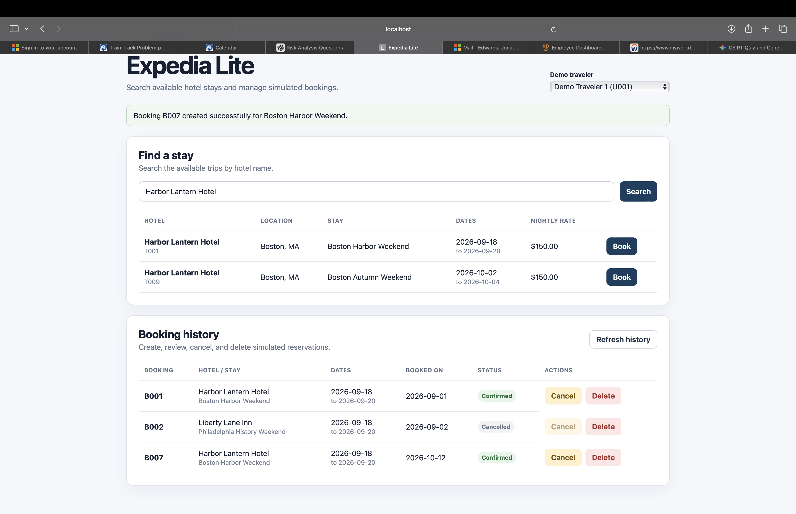
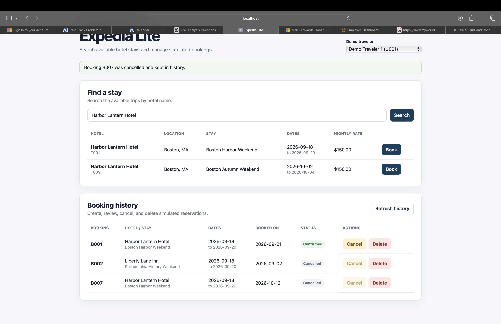
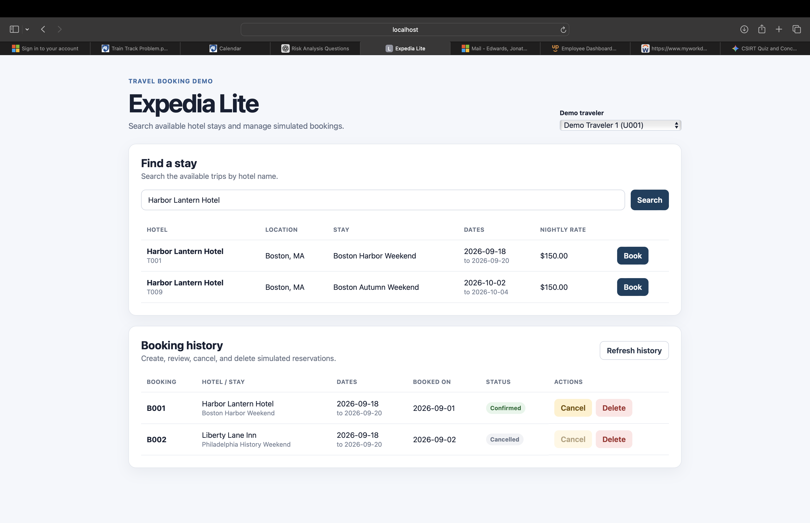

# Expedia Lite — Part 2

## Repository and commits

Repository URL: https://github.com/ManzanKid/part1_travel_app

Exact Part 1 commit: 3e510471bb23be3891b715117370ff21b112c4cd

Exact Part 2 commit: fd6b3e5798d47169e6d555b9f44ed38be09d5ee

## Implementation

Part 1 implemented hotel-name search using Vue for the frontend and FastAPI/Python for the backend. The backend read `hotels.csv` and `trips.csv`, connected the records using `hotel_id`, and returned matching stays to the frontend.

Part 2 adds SQLite persistence and simulated booking CRUD. The supplied `hotels.csv`, `trips.csv`, `users.csv`, and `bookings.csv` files are used to seed SQLite the first time the database is created. After the initial seed, the application reads and writes data through SQLite instead of reloading the CSV files.

The backend uses an MVC-style structure. `models/database.py` manages the SQLite database and initial seed. `controllers/database_controller.py` performs hotel search and booking CRUD operations. `main.py` provides the FastAPI routes. The Vue frontend acts as the View and allows a demo traveler to search for stays, create bookings, view booking history, cancel bookings while keeping the record, and delete test bookings.

## Verification

### Part 1 search

Action: Search for `Harbor Lantern Hotel`.

Expected result: Two matching stays appear: `T001` — Boston Harbor Weekend and `T009` — Boston Autumn Weekend.

Observed result: I searched for `Harbor Lantern Hotel` and saw both `T001` and `T009`. Both results showed Harbor Lantern Hotel in Boston, MA with a nightly rate of $150.

Action: Search for `zzzz-no-hotel`.

Expected result: No matching rows appear and the application shows a clear no-results message.

Observed result: The application displayed `No results found for "zzzz-no-hotel".`

### Create booking

Action: Select Demo Traveler 1 (`U001`), search for `Harbor Lantern Hotel`, and click `Book` for `T001`.

Expected result: A new booking with a unique ID appears in booking history with a `Confirmed` status.

Observed result: I clicked `Book` for `T001` — Boston Harbor Weekend. The application created booking `B007`, displayed a success message, and immediately added `B007` to the booking history with a `Confirmed` status.

### Read booking history

Action: View the booking history for Demo Traveler 1.

Expected result: The existing seeded bookings and the newly created booking are displayed.

Observed result: The booking history showed the existing `B001` and `B002` records along with the new `B007` booking. `B001` was confirmed, `B002` was cancelled, and `B007` was confirmed after it was created.

### Cancel booking

Action: Cancel booking `B007`.

Expected result: The booking remains in history, but its status changes from `Confirmed` to `Cancelled`.

Observed result: I cancelled `B007`. The booking stayed in the booking history and its status changed from `Confirmed` to `Cancelled`.

### Persistence after browser refresh

Action: Refresh the browser after cancelling `B007`.

Expected result: The booking remains in history with the updated `Cancelled` status.

Observed result: After refreshing the browser, `B007` was still present and its status remained `Cancelled`.

### Persistence after frontend and backend restart

Action: Stop and restart both the frontend and backend, reopen the application, and view Demo Traveler 1's booking history.

Expected result: The saved booking and its updated status remain in SQLite without reloading or duplicating the starter records.

Observed result: After restarting both the frontend and backend, `B007` was still present and remained `Cancelled`. The original booking records were still present and were not duplicated.

### Delete booking

Action: Delete the test booking `B007`.

Expected result: `B007` disappears from booking history.

Observed result: I deleted `B007` and it disappeared from the booking history. After refreshing the browser, `B007` did not return, confirming that the deletion persisted in SQLite.

## Demo video

Video: (https://drive.google.com/file/d/1N4PVYoTFd2H-Gd0w4oeA8v7c8DxnnP7q/view?usp=sharing)

## Project context and next steps

README: `README.md`

Project-specific agent instructions: `AGENTS.md`

Design note: `docs/design.md`

Selected prompts: `prompts/`

Current handoff: `handoffs/current.md`

Remaining limitations / next task: The required Part 2 search, booking CRUD, SQLite persistence, demo video, and final merged-app verification were completed successfully. The Part 2 implementation was verified on the main branch after the feature branch was merged.