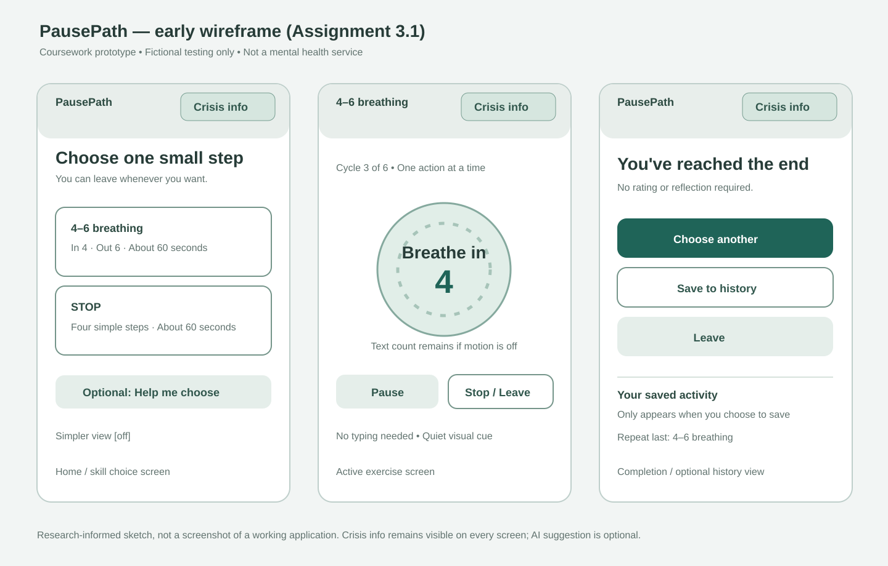

# Assignment 3.1 — Research and Design

**Proposed application:** PausePath — a coursework mental-health skills prototype  
**Repository:** https://github.com/ManzanKid/part1_travel_app  
**Development branch:** `assignment3-part1` (create before adding these files)  
**Design checkpoint commit:** `ADD_DESIGN_COMMIT_HASH` (fill in after the design files are committed; submit the final report commit hash separately in Canvas)  
**Milestone:** Research and Design; no working application is claimed

## What I propose

PausePath is a small, local-first Vue/FastAPI/SQLite prototype that lets a person practicing a **fictional scenario** choose either **4–6 paced breathing** or the **STOP** skill. The user can skip the model, start a skill directly, pause or leave without penalty, and open a persistent crisis-information link from every screen. No diagnosis, therapy, treatment recommendation, or monitoring is offered.

I selected these two skills because neither requires the user to type out distressing personal material. A paced-breathing session will guide six cycles of a four-count inhale and six-count exhale (60 seconds). STOP will preserve its four steps in order: Stop; Take a step back; Observe what is happening internally and externally; Proceed mindfully. Both are designed to finish within **90 seconds** at their intended pace. The skill instructions and timers are deterministic, not generated by the language model.

## Research connection and rationale

The course-provided study summary reports 15 patients, 13 clinicians, 15 prototype evaluation sessions and 150 coded participant–task combinations. The counts are *mentions and design evidence*, not proof that the skills are clinically effective.

- **R1 (38 mentions):** A short, bounded exercise is less demanding than a long guided chat. Planned paced breathing lasts 60 seconds; STOP lasts about 60 seconds.
- **R2 (30) and D4 (31):** A clearly named **Crisis information** control stays visible on every screen, even if the model fails, with static U.S. information for 988 and 911 in an immediate emergency.
- **R3 (39):** **Stop / Leave** and **Pause** remain available without scoring, warnings or forced reflection.
- **R4 (68):** Users choose their skill and may ignore a model suggestion. No automatic redirection is allowed.
- **D1 (54):** A user-controlled **Simpler view** removes secondary text and animation. I will *not* infer emotional distress from typing, behavior or a score.
- **D2 (100):** Exercise screens present one instruction at a time.
- **D3 (148):** Neither skill requires emotional disclosure, journaling or even speaking. Model input is optional.
- **D5 (49):** With permission to save practice history, the home screen may offer **Repeat last skill**. No initial personalization questionnaire is required.
- **D6 (97):** Short, plain labels, muted colors, little motion and nonjudgmental language replace clinical or overly cheerful copy.

This design favors control and low effort over rich automation. For example, retaining session history can help users repeat a familiar skill, but recording personal information adds privacy cost. I therefore plan an optional **Save to history** action, not mandatory chat logging. Full decision mapping appears in the [design notes](docs/assignment3/part31-design.md).

## Main experience and early design artifacts

- [Research, feature scope, safety, timing, data, tradeoffs and unresolved questions](docs/assignment3/part31-design.md)
- [Flow diagram and screen-by-screen behavior](docs/assignment3/part31-flow.md)
- [AI-use and selected design evidence](docs/assignment3/part31-ai-evidence.md)

These artifacts are **early design work**, not screenshots of a functioning application.

## Model contribution and boundaries

A backend-connected conversational model will have one optional role: interpret a short **fictional** request such as “I want something simple” and suggest *one of the two predefined skills*, accompanied by a short, neutral explanation. The user can accept, ignore or change the suggestion. On a later opt-in history view, it may summarize factual saved activity (such as which skill was used last), not evaluate mental health.

The application, not the model, controls the skill steps and timing, saving/deleting data, persistent help link, exit/pause actions, and crisis behavior. The model never invents therapeutic steps or decides whether crisis information appears. If unavailable, the static skill selector works normally.

For crisis-related fictional input, the planned app will stop the optional AI response and show neutral crisis-information wording; keyword detection will be identified as incomplete and not clinically reliable. The crisis route will remain available independently of this detection. U.S. reference: [988 Lifeline — Get Help](https://988lifeline.org/get-help/).

## Planned data and verification

The proposed SQLite design includes `practice_sessions` (skill, timestamps, outcome and measured duration), `chat_threads`/`chat_messages` (optional fictional model interactions saved with consent), and `preferences` (minimal last-skill and simpler-view settings). History will list saved sessions and offer deletion. Raw emotional text is not required to use either skill. Nothing is uploaded for research or real clinical use.

For Part 3.2 I will test one complete skill through the running Vue/FastAPI/SQLite interface, model contribution, opt-in persistence, timing, and independent crisis access—including a model failure and leaving mid-exercise. For Part 3.3 I will use **at least 15 fictional scenarios**, three cross-case behavior checks, mocked model responses for repeatability, a small set of live-model checks, and an explanation of a discovered failure and revision. The target exercise duration is measured from first instruction to final planned step, with setup time separately reported; user-chosen pauses are outside that time as allowed by the brief.

## Open questions and limitations

1. Will auto-advancing STOP instructions feel too rushed? Compare 15-second timed steps with a user-driven Next control in fictional testing.
2. Will a breathing animation distract users? Provide a text/count alternative and reduced-motion mode.
3. Does an optional save button strike the right balance between useful history (D5) and low emotional cost (D3)?
4. How can a failed or invalid model recommendation be communicated with minimal interruption?
5. Does the chosen model behave consistently within the two-skill allowlist across fictional prompts?

**Status:** Part 3.1 design proposed. No live model calls, participant studies, or measured timing results have yet been claimed. All usability and safety outcomes are hypotheses to test, not established effects. This is a **coursework prototype for fictional scenarios only**, not a mental health service.

## AI disclosure

I used **OpenAI ChatGPT (GPT-6)** to organize the instructor-provided study findings, compare design options, and draft these initial planning documents and wireframe. I reviewed the choices against the assignment brief. No claims are made that Codex generated or tested an Assignment 3 application at this stage. See [AI design evidence](docs/assignment3/part31-ai-evidence.md). Before later milestones I will record the coding agent and live LLM model identifiers actually used, plus selected prompts, corrections and test evidence.
